# WhatsApp menu diagrams

Initially source-reviewed against `1.1.4` at `4cb09ae`; terminal labels and return edges aligned with the 041 menu-polish working tree based on `8f32898`. This is a map of the implemented menus, not a proposed redesign or live-client acceptance report. English labels are used; chat names, account scopes and status values are abbreviated. Terminal categories, labels, headings and hints are localized in English, pt-BR, Spanish and French.

## Reading the diagrams

- Solid arrows show a selection, child screen or action; they do not mean every action runs in sequence.
- Dotted arrows explicitly show Back or another return. Repeated returns after individual edits are described in the text instead of drawing every loop.
- Conditions on arrows identify options that are not always visible.
- **Cancel/Esc is not a universal menu item.** Cancelling a select/input/editor closes the whole terminal settings request. Confirmation No/Esc leaves that action unchanged; its caller decides whether the current panel remains open. Message-detail overlays have their own local close gesture.
- The root exit is **Close settings**; child exits name their actual destination. Select/input/editor titles include **Esc closes settings**. Closing message detail returns to **History**, not out of settings.
- Existing English-only confirmation titles/bodies (Off, optional reporting, group context, automatic images and terminal forwarding) and the privacy/log policy notice stay unchanged in every locale. Consent/review translations are preserved; terminal-path citations in phone guidance and the pairing welcome follow the localized labels.
- Every nested terminal dialog retains the original account/session/owner authority. Expiry closes the request and asks the operator to reopen `/whatsapp`; Back never renews that authority.

## 1. Terminal entry point

Run `/whatsapp` in Pi. The root title shows Enabled/Off and the transport status separately.

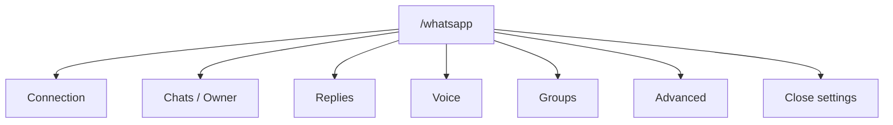

**Voice is a direct root panel**, not a child of Replies or Chats / Owner. Owner and Optional outputs are wired into the production entry; their absence in a reduced test adapter is not an operator setting.

## 2. Connection and Advanced

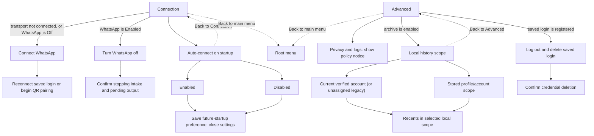

- Connect/Off/logout finish with their outcome, not an automatically reopened menu. Declining Off/logout also ends that request without the requested mutation.
- Off retains login, history and preferences. It is different from **Log out and delete saved login**.
- Auto-connect changes future TUI/RPC startups/session loads, not the current connection. Enabled/Off and connected/disconnected are different states: **Turn WhatsApp off** can appear while the transport is disconnected.
- Local history scope changes the reader's view, not the account used for live ingestion. Recents opened this way returns to **Advanced**, including when it is empty.

## 3. Allowed contacts and groups

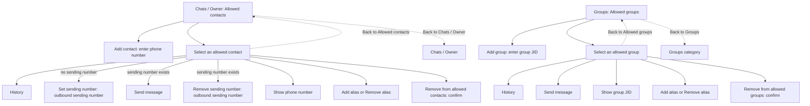

**Add contact** adds allow-list membership. A contact's **Set sending number / Remove sending number** controls its separate outbound send-number override; it does not add/remove the contact. The contact's Send message option appears only when that override exists. Group Send message does not have that condition.

Adding an entry returns to its list. Alias/send-number edits, printing, sending and returning from History reopen the selected entry. Removing an entry, or declining its removal confirmation, returns to the list. Only the alias action appropriate to the entry's current state is shown.

## 4. Owner selection

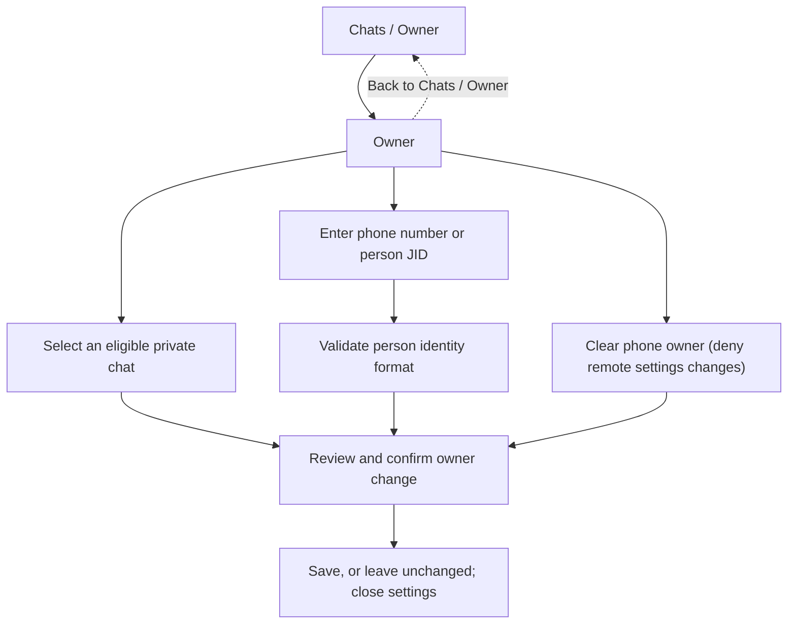

Known choices exclude groups and respect the current allow-list/group binding. Manual input accepts a valid phone number or full person JID; bare internal-ID digits are not a substitute for verified identity. Selecting an allowed chat does not itself make that person the owner. Owner selection is separate from speech consent.

## 5. Recents, History and quoted replies

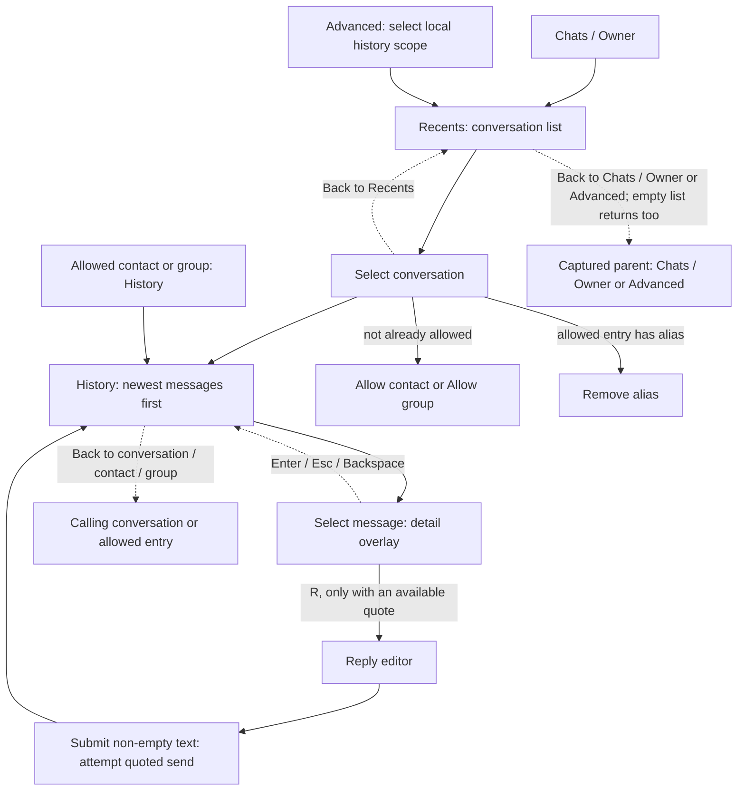

- Recents and History show up to ten entries per page, with **Previous page / Next page** only when applicable. History Next page may load older archived records locally; it is not a network history request.
- Allow/Remove alias returns to the selected recent conversation. An empty History shows a notice and returns to its caller.
- The quote is checked again before opening the reply editor. An unavailable quote does not silently become an unquoted reply.
- Enter/Esc/Backspace closes only the detail overlay. Cancelling the reply editor closes the settings request; submitting empty text keeps that editor open. A send outcome returns to History and does not prove recipient delivery.

## 6. Replies and optional outputs

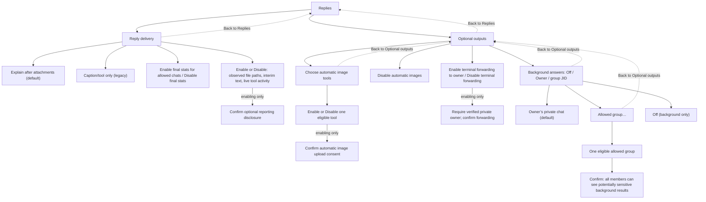

These are **shared reporting/delivery controls**, not the per-chat Text/Voice/Both/Mirror picker. A successful selection saves for future inputs and closes the settings request. Reporting/tool/forwarding labels change with their saved state; the two final-stats choices are both offered.

Automatic image consent is per tool and covers actual inline image results, not paths mentioned in text. Terminal forwarding requires a connected, allowed private owner and retains no permission across an owner/account change. Turning these on does not replay existing work. A missing eligible owner refuses forwarding rather than selecting a fallback recipient.

Background answers have independent, default-off consent for the verified owner or exactly one allowed group, with group disclosure. Only known-start runs consuming custom messages or exactly proven extension-origin user messages qualify, including live-session cron delivery; router control origin and owner authorization are unchanged. Terminal+custom (including steer), WhatsApp-owned and ambiguous work never uses this projection; existing routing/terminal forwarding remains unchanged. Text only, 64 KiB local limit, no replay/retry/fallback; connection/account/consent and allowed, unpaused, bound-group eligibility are rechecked. See [background-answer behavior](reference.md#background-answers).

## 7. Voice: overview and per-chat setup

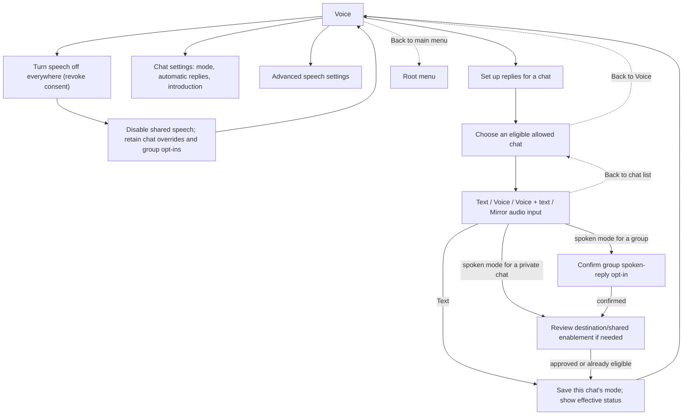

- The chat picker uses allowed contacts/groups eligible within the current binding, not arbitrary recipients. No available chat produces a notice and returns to Voice.
- Spoken choices require group opt-in when applicable, plus destination approval/shared enablement. Declining setup consent returns to Voice without saving the staged change.
- Enabling shared speech may reactivate retained defaults/overrides in other eligible chats; paused chats stay paused. Choosing a mode does not unpause a chat.
- Mirror speaks for verified audio input and otherwise uses text. **Text** changes one chat's mode; **Turn speech off everywhere (revoke consent)** disables shared speech and revokes approval.
- If saved voice/reply preferences are invalid, the normal Voice menu is replaced by **Reset voice / reply preferences** and **Back to main menu**. Reset requires confirmation and clears backend/consent/chat overrides; it preserves login, allowed chats, STT and history.

### Existing chat controls

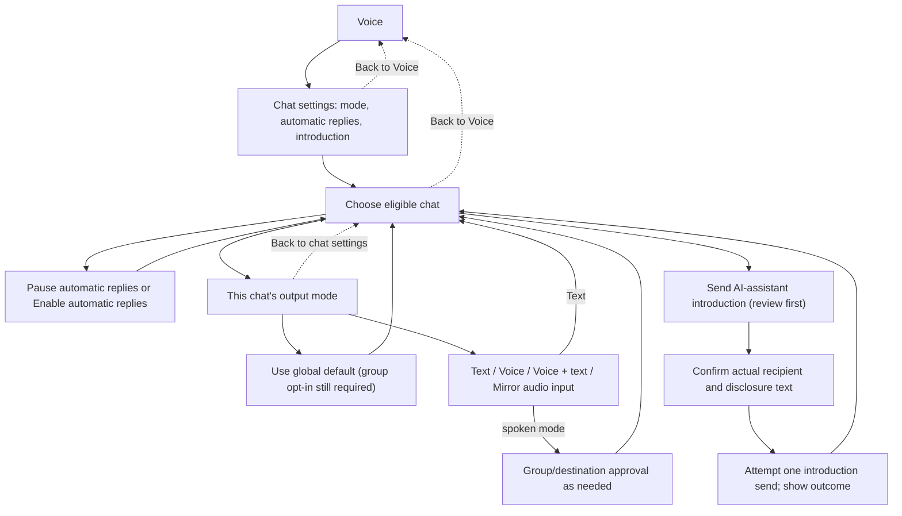

The chat-controls panel stays open after a successful edit or an introduction outcome. **Introduction is a send**, unlike saving a mode. It requires its own exact-recipient confirmation and a current connected/idle context. Returning from this panel goes to Voice, not back to the chat picker. Inheriting the default does not itself grant group opt-in or destination consent.

## 8. Advanced speech settings

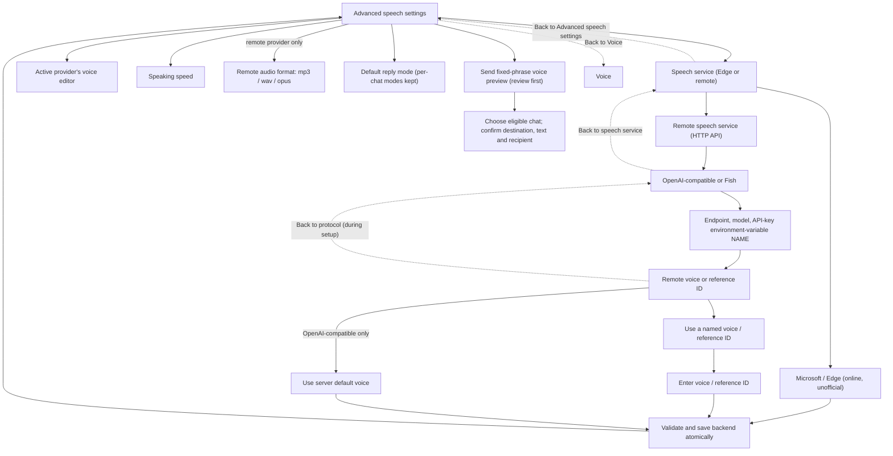

- For Edge, the voice editor is **Edge voice** followed by locale input. For remote providers it is **Remote voice or reference ID**, with named/server-default choices as above. Server-default is never offered for Fish. Back from that standalone remote voice editor returns to Advanced, whereas Back during backend setup returns to the protocol picker.
- Remote setup values are staged and saved together. Blank endpoint/model/key-variable fields retain existing values; incomplete/invalid configurations are refused. Store the environment-variable name, never an API key value.
- Here “Remote speech service (HTTP API)” means an HTTP API backend; permitted loopback local servers can use this path too. This is the TTS menu, not an STT provider configuration screen.
- Speed, format, default-mode and voice edits return to Advanced. A spoken shared default requires appropriate destination/shared-enablement consent; choosing Text does not perform the global revoke action. Back from a mode/format picker returns to Advanced.
- Backend changes can revoke existing destination approval. Saving a matching trusted managed-server configuration can start/health-check that server, but **does not synthesize or send a preview**. See the [speech settings contract](reference.md#speech-replies) and [managed-server setup](crispasr.md#optional-managed-startup).
- Preview is a separate, confirmed fixed-phrase synthesis/upload attempt. Its outcome returns to Advanced; it neither enables ongoing speech nor grants ongoing consent.

## 9. Group replies

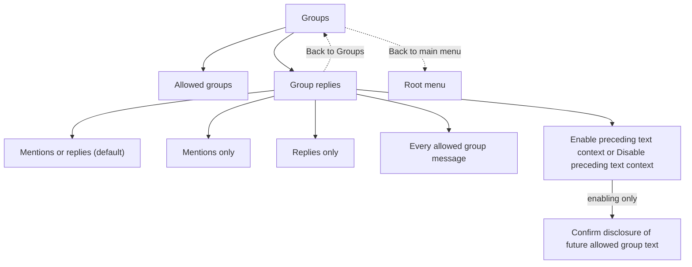

Saving a policy ends the settings request; paused chats remain paused. Trigger policy and preceding context are separate from allow-list membership, speech opt-in and owner authorization. Invalid saved group policy produces a repair title and requires an explicit choice; merely pressing Back does not repair it. Context limits and lifecycle behavior are in the [group contract](reference.md#routing-and-optional-output).

## 10. WhatsApp phone menus: a separate surface

Phone presentation aligned on 2026-11-08 with the 042 working tree based on `4f5388a`; this remains a source-coherence map, not live-client evidence. Phone slash commands do not open the terminal `/whatsapp` hierarchy. State-changing commands require the configured, verified owner in an allowed chat; `/help` and `/status` are available to admitted non-owner actors too.

```mermaid
flowchart TB
    Phone["Allowed chat: phone slash commands"]
    Phone --> Help["/help: grouped commands with explanations"]
    Phone --> Status["/status: Shared Pi and WhatsApp / This chat"]
    Phone --> Owner["Verified owner required for other commands"]
    Owner --> Models["/model: authenticated model picker"]
    Models --> Pages["Ten models per page; Previous page / Next page"]
    Owner --> Think["/think: supported thinking levels"]
    Owner --> Voice["/voice: Text only / Voice / Voice + text / Mirror audio input"]
    Owner --> Replies["/replies: shared attachment policy, stats and reporting"]
    Owner --> Confirm["/new, /off, /quit: Cancel / Confirm menu"]
    Owner --> Direct["/stop or /abort; /compact with optional focus"]
    Models --> Choice["Choose using a valid numbered reply or enabled native poll"]
    Think --> Choice
    Voice --> Choice
    Replies --> Choice
    Confirm --> Choice
    Choice --> Current["Recheck current menu/owner/account and command guards"]
    Current --> Apply["Apply selected action or report refusal"]
```

- `/model search` opens filtered choices; only a typed exact authenticated `provider/model` selects directly. `/think level` and `/voice mode` also accept direct values. No generic phone Back action is invented here.
- Numbered menus expire after five minutes and bind to the requesting actor/chat/account. Group numbered replies must quote the active menu. Ordinary text cancels the pending menu. Native polls are an optional, default-off alternative; the numbered menu remains available.
- Phone `/voice` never enables shared speech, approves a destination or opts a group in; missing permissions point back to terminal chat setup. Phone `/replies` keeps its full disclosure (including the invalid-settings note) in the numbered text message’s body, never in a truncated title or poll name; it does not add the terminal’s additional confirmation dialog.
- `/help` groups Information, Shared Pi session (including `/replies`), This chat (`/voice`), and WhatsApp and process. `/status` retains every field under the two shown sections. Known exclusive choices carry a localized `(current)` suffix; independent reporting toggles show their state. Shared-session guidance is in the message body, with a short title used by the optional poll.
- The same existing locale override selects English, pt-BR, Spanish or French for all phone presentation. Commands/arguments and model IDs are not translated; no per-chat language setting is added.
- State-changing selections normally require idle shared Pi work; model pagination is navigation, not selection. `/stop` explicitly cancels work, and confirmed `/off`/`/quit` are separate lifecycle actions. `/off` requires the terminal to turn WhatsApp on again. `/quit` shuts down Pi, not just WhatsApp.

## Coherence review

The diagrams were checked against the current chooser, action handlers, entry wiring, labels and navigation tests. The following differences are implemented behavior, not missing diagram links:

| Check | Result |
| --- | --- |
| Root placement | Voice is direct; Owner is under Chats / Owner; Optional outputs is under Replies. |
| Conditional options | Connect/Off depend on separate transport/enablement state; logout needs saved registered login; history scope needs an enabled archive; contact Send message needs a send-number override. |
| Back destinations | Auto-connect returns to Connection; Recents preserves Chats / Owner versus Advanced; a selected Voice chat returns directly to Voice; remote voice Back depends on its caller. |
| Save/close behavior | Many non-Voice actions close settings; Voice's normal panels loop after saves. No universal automatic return-to-parent after saving is implied. |
| Egress and authority | Owner, allow-list membership, speech consent and optional-output consent are distinct. Preview/introduction/manual message send are explicit sends; normal configuration saves are not. |
| Overlay versus cancellation | Closing message detail returns to History; cancelling select/input/editor closes the request; confirmation No/Esc retains caller-specific behavior. |
| Surface separation | Terminal menus and owner-only phone control menus are separate, with different presentation and confirmation mechanics. |

No contradictory parent path was found in the reviewed handlers. The main UX asymmetries are that some completed actions close settings while others keep a panel open, and that contact Send message requires a separate send-number override. The diagrams preserve those differences rather than silently normalizing them into a more uniform design.

This is a static source-coherence review, not proof of terminal rendering, provider availability or recipient delivery. No real account, saved settings, speech server or provider was exercised to write it.

### Source and maintenance pointers

- [Root chooser and scoped navigation](../src/ui/whatsapp-settings.view.ts)
- [Menu actions, contacts, groups, Recents and History](../src/ui/menu.handler.ts)
- [Voice, backend, per-chat and Owner views](../src/ui/voice-settings.view.ts)
- [Optional-output settings](../src/ui/optional-output-settings.view.ts)
- [Message detail](../src/ui/message-detail.view.ts) and [quoted reply editor](../src/ui/message-reply.view.ts)
- [Composition and command registration](../whatsapp-ng.ts), [English/localized labels](../src/i18n.ts)
- [Phone command router](../src/services/whatsapp-command.router.ts) and [ephemeral phone-menu service](../src/services/command-menu.service.ts)
- [Scoped-navigation tests](../tests/unit/settings-navigation.test.ts), [menu-handler tests](../tests/unit/menu.handler.test.ts), [Voice tests](../tests/unit/voice-settings.view.test.ts), [optional-output tests](../tests/unit/optional-output-settings.view.test.ts)

Keep labels, conditions and return edges aligned with these owners when menus change. Linking this document from README is a separate editorial decision.
