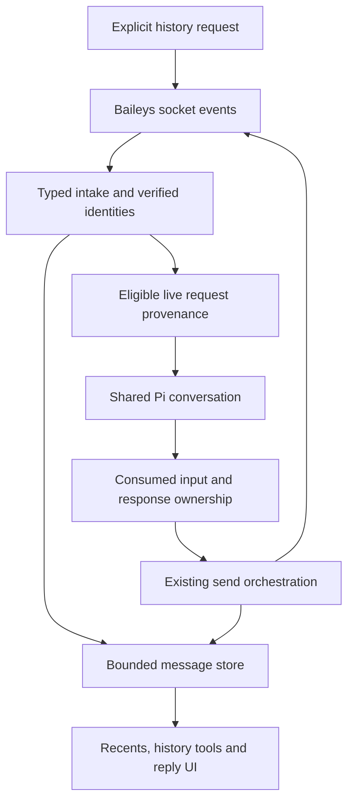
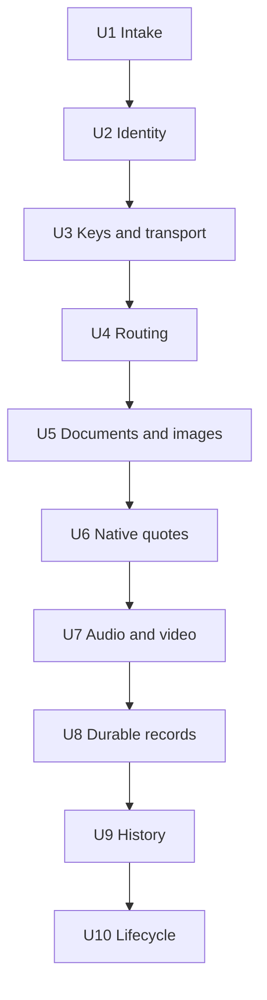

# Implementation Plan: Baileys Capability Roadmap

**Feature**: `036-baileys-capability-roadmap` | **Spec**: [spec.md](spec.md) | **Tasks**: [tasks.md](tasks.md)
**Implementation status**: Phases 1–2 (U1–U7) implemented and validated. Phase 2 is on `feat/baileys-everyday-usefulness`, based on `948f539`; the fork owner subsequently authorized committing, pushing to the fork and opening an upstream PR dependent on Phase 1 PR #14. This is publication approval, not upstream maintainer approval. Phase 3 is not started or authorized.

### Phase 2 execution and validation

- The fork owner authorized Phase 2, an independent `openai-codex/gpt-6.1-sol` review and live sends to an explicitly designated test recipient. User-selected branch separation keeps the Phase 1 upstream PR unchanged.
- U5 adds explicit media sending with approved-root/credential checks, bounded owned snapshots, metadata-only tool results and shared stable-ID transport. Caller interruption after transmission is unknown; ownership and cleanup persist until the transport settles.
- U6 adds native scoped quotes to text/media tools and the existing reply UI. Quotes preserve observed transport addresses, revalidate retained targets before send, reject missing/deleted/expired/ambiguous/cross-chat payloads and record the quote ID. Minimal raw-cache deletion invalidation supports quote safety; full lifecycle fidelity remains Phase 3.
- U7 adds audio/PTT/video, shared existing FFmpeg executable resolution, compatible pass-through and bounded codec conversion. Child abort/timeout waits for exit; converted size is checked. No new dependencies, package upgrades, TTS or remote fetching.
- Final isolated validation: `npm test` — **345 passed across 34 files**; `npm run lint` — passed; `npm run typecheck` — passed; `git diff --check` — passed. Test commands used temporary `HOME` and `PI_CODING_AGENT_DIR`. No build script is declared. Real FFmpeg codec and native Baileys contract cases ran on this host, not just fake sockets.
- Isolated startup: `pi --mode rpc --no-session --no-extensions --no-skills --no-prompt-templates --no-themes -e ./whatsapp-pi.ts` returned a successful `get_state` response without credentials/auto-connect. An active LSP error probe reported zero errors; eight silent-on-clean paths were unconfirmed, so the successful declared typecheck is the authoritative project check.

#### Phase 2 independent review

The requested **`openai-codex/gpt-6.1-sol`** read-only reviewer inspected the candidate and performed a focused re-review after fixes. Runtime status confirmed the explicit model override despite a different configured reviewer default. The reviewer could inspect source/tests but could not execute commands. All validation commands below are parent-run evidence, not independently rerun tests.

| Finding | Correction and regression evidence |
|---|---|
| P1: Baileys recreates plaintext outside private snapshots | Supply bounded precomputed JPEG thumbnails and probed audio seconds; explicitly unavailable PTT waveform disables the native decoder. `native-media.contract.test.ts` runs actual `prepareWAMessageMedia` under child-process umask `022` and observes zero plaintext original copies for image/audio/PTT/video. |
| P1: Native video thumbnails launch an unbounded child | Thumbnail creation uses the same bounded FFmpeg runner and preparation deadline. Native consumer instrumentation observes zero extra shell executions; thumbnail abort/timeout fixtures wait for child close before unlinking. |
| P1: Ancestor replacement bypasses path checks | Compare pre-open regular-file identity and non-symlink ancestor identities with the opened descriptor/path, then repeat stability/ancestry checks after copying. Deterministic harmless outside-symlink replacement rejects before upload. This is not an OS sandbox. |
| P1: A FIFO can block open indefinitely | Pre-check regular files, open with `O_NOFOLLOW`/`O_NONBLOCK` where supported and verify with `fstat`. Existing/replacement FIFO regressions reject promptly without leaving blocked filesystem work. |
| P2: Own/LID native quote serialization not established | Actual native generation tests cover incoming/own direct and group cases. Own-LID group authors are explicitly unavailable because rc14 rewrites them to the account PN; incoming LID authors remain supported. |
| P2: Tests stop before the native consumer | Added real native media/quote contract suites in addition to codec, tool, UI, delayed transport and delayed-child cleanup fixtures. |

All reported defects were reproduced by failing regressions before correction. Focused independent re-review: **“No issues found”**, all six findings resolved, **“OK with notes”** about the remaining live-validation step. That live step was subsequently completed as follows.

#### Authorized live WhatsApp validation

The operator explicitly approved using the saved linked-device session, including potential takeover of an existing connection. A standalone harness exercised the repository's real `WhatsAppService`/`MessageSender`/`OutgoingMediaService` path against the designated recipient. It did not start an agent, upload business files, copy credentials, migrate auth, modify Pi settings, or log out. Harness status/allowlist handling was memory-only; normal Baileys credential refresh was retained. The harness disconnected afterward, and saved auth remained present.

**11/11 sends were accepted**: text anchor, native quoted text, generated PDF, XLSX, Markdown, PNG, JPEG, MP3 audio, WAV-to-Opus voice note, compatible MP4 video and AVI-to-H.264 video. All 10 reply messages retained the native quote stanza ID in the actual returned protocol content. All fixtures were generated and non-sensitive. No uncertain send was automatically retried.

Recipient receipt events were not captured; acceptance alone is not treated as delivery/read evidence. The operator checked the designated phone and explicitly confirmed **“All arrived and worked”**: files opened, audio/video played, and quoted replies displayed correctly. This is manual client-validation evidence, not instrumented read tracking. Live group rendering and every alternative codec/device remain untested; scoped/group behavior and failure cases have offline coverage. Public artifacts omit the recipient's number and credential/session contents.

### Phase 1 execution evidence

- Branch: `feat/baileys-foundation`; no dependency changes, global configuration edits or live WhatsApp sends.
- T034: the custom-message candidate failed the input-policy characterization gate. The user approved preserving `sendUserMessage` with an opaque, exact-content-correlated sidecar instead. This is the implemented U4 design; the custom-message approach below remains historical planning context, not an instruction to replace the working transport.
- Sidecar compatibility: isolated `pi -e` probes covered text, image, policy blocking, transformed-content fail-closed behavior and queued chats. Declared SDK `0.73.1` is additionally exercised offline by `tests/unit/pi-routing.compatibility.test.ts`; runtime host `pi --version` reports `1.3.0`.
- Ownership activates only for observed matching user inputs; snapshots bind destinations through tool execution. Post-tool mirroring, concurrent send suppression, delivery-unknown suppression, retries, terminal/multi-chat ambiguity, aliases and reset/slow-media cleanup have regression fixtures.
- Latest post-review commands: `npm test` — **294 passed in 28 files**; `npm run lint` — passed; `npm run typecheck` — passed; `git diff --check` — passed. Test runs used isolated temporary `HOME` and `PI_CODING_AGENT_DIR` directories.
- Isolated startup: `pi --mode rpc --no-session --no-extensions --no-skills --no-prompt-templates --no-themes -e ./whatsapp-pi.ts`, with temporary `HOME` and `PI_CODING_AGENT_DIR`, returned a successful `get_state` response.
- Active LSP checks were run; inferred-test mock typing was corrected. Auxiliary pattern warnings include existing code and copy-before-reverse false positives; no blanket clean-LSP claim is made.
- Independent source review subsequently completed with `openai-codex/gpt-6.1-sol`; the reviewer was read-only and had no command-execution tool. Parent-run regression tests reproduced the reported runtime failures before correction. See the correction record below.
- Not run: live-account delivery/rendering and interactive TUI visual checks; no live-account operations were authorized. SDK/lifecycle fixtures are not evidence of live WhatsApp delivery.
- Phase 2 media/quotes and Phase 3 persistence/history/lifecycle work remain out of scope for this execution.

### Source-review correction record

1. **P1, retry keys:** added transport-specific outgoing lookup that ignores the retry requester's participant, while retaining strict full-key matching for reactions/general lookups. Direct/group receipt-shaped callback tests cover account, chat and direction isolation without Baileys' internal retry cache.
2. **P1, outgoing group authors:** preserve Baileys' observed top-level `participant` in the stored key. A real sender/store/reaction seam test verifies successful reaction targeting without inventing an author.
3. **P1, stale account work:** pin one account/auth scope and generation at batch admission, carry it through media preparation and command handling, and guard late mapping mutations and obsolete socket callbacks. Same-account reconnects deliberately preserve admitted work; account round trips, logout and explicit stop cannot revive an old generation. Related pre-send waits and late send responses are fenced to prevent using or caching into a replacement account.
4. **P2, ordinary π-ending input:** restrict legacy branding rejection to `fromMe`; `Calculate 2π` from an allowed contact is recorded and processed, and owned-echo regression coverage remains.
5. **P2, stale specification:** updated spec approval history/status and the approved sidecar deviation; later phases remain unauthorized. No upstream maintainer approval is implied.

All five findings were addressed locally; the initial reviewer verdict is not represented as a post-fix approval. Post-fix validation passed: 294 tests in 28 files, lint, typecheck and `git diff --check`. Final isolated `pi --mode rpc --no-session --no-extensions --no-skills --no-prompt-templates --no-themes -e ./whatsapp-pi.ts` startup returned a successful `get_state` response. The active LSP probe reported zero errors, but seven silent-on-clean paths were unconfirmed; the successful declared typecheck is the authoritative project check. Routing scope includes session generation so returning to the same account cannot reactivate an old response epoch.

The local first-contact PR draft is `PR1.md`, ignored by `/PR1.md` in `.gitignore`. After implementation and review, the fork owner authorized committing Phase 1, pushing the feature branch to the fork, and opening an upstream PR. This does not authorize later implementation phases or imply upstream approval.

**Target**: `jagaliano/whatsapp-pi`, based on upstream commit `9e12203`, extension `1.0.71`, installed `baileys@7.0.0-rc14`.

## Summary

Deliver three independently reviewable phases:

| Phase | Outcome | Units | Exit gate |
|---|---|---|---|
| 1. Foundation | Complete intake, verified identities/keys, truthful retries, and destination-safe replies. | U1–U4 | Batch/replay/identity/routing regressions pass. |
| 2. Everyday usefulness | Documents/images, native quoted replies, then audio/voice notes/video. | U5–U7 | Supported content sends correctly through tools and existing UI seams. |
| 3. Conversation fidelity | Durable bounded records, explicit history/backfill, and lifecycle reconciliation. | U8–U10 | Restart/migration/history/lifecycle scenarios converge without new prompts. |

The user's chosen trust model is unchanged: allowed chats share one Pi conversation and may influence one another's model context. This plan fixes routing, not multi-tenant confidentiality.

---

## Technical Context & Owner Conventions

- TypeScript in strict mode, ES2022, NodeNext modules, `.js` local imports in source; tests follow existing `.ts` imports.
- Existing runtime dependencies remain unchanged: Baileys, TypeBox, Pino, FFmpeg, Whisper, LiteParse. No new database, package, SDK orchestration, or generic event framework.
- Class-based services own state and side effects; interfaces/discriminated unions describe contracts. Follow the four-space service style, existing file naming, constructor injection, small methods, and async/await. Do not copy existing `any` casts into new boundaries.
- `whatsapp-pi.ts` remains the composition root: flags, Pi event handlers, tool registration, and wiring. Protocol, storage, identity, conversion, and routing state belong in focused services.
- Reuse `SessionManager`, `WhatsAppService`, `MessageSender`, `ReactionSender`, `RecentsService`, `IncomingMediaService`, and `storage-path.ts`; add a service only for a distinct responsibility.
- User-facing strings go through `src/i18n.ts`, including the existing English/Portuguese/Spanish structure. Reuse the current menu/editor flow instead of adding a UI framework.
- The actual current storage root is resolved by `createStoragePaths()` using the plural `extensions` directory. Historical spec 035 mentions older singular paths; fresh source is authoritative. Add paths through that helper, never repeat a hard-coded home path.
- The repository declares `@mariozechner/pi-coding-agent` as `latest`; the inspected installed package is `0.73.1`, while the installed host is the renamed `@earendil-works/pi-coding-agent`. These are not a pinned compatibility guarantee. Record actual package/host versions at implementation time and pass U4's explicit compatibility gate; do not silently migrate imports, pin/upgrade dependencies, or rely on global-host-only APIs without approval.

### Constitution Check

- [x] OOP: focused stateful services; existing lightweight resolver helpers stay helpers.
- [x] Clean Code: small responsibility-oriented units, no entrypoint-wide rewrite.
- [x] SOLID: typed seams for identity, transport, message lookup, and routing; no speculative generic abstraction.
- [x] TypeScript: strict discriminated contracts and Baileys event/message/key types or narrow typed projections.
- [x] Simplicity: local bounded collections/JSON, existing tools/UI patterns, no new runtime dependencies.

**Complexity tracking**: A small message store and provenance router are justified by distinct lookup/lifecycle responsibilities. A database, per-chat agent fleet, durable job system, and generic repository/event-bus layers are rejected as unnecessary for this scope.

---

## Requirements Trace

The agreed scope and planning acceptance scenarios are authoritative in [spec.md](spec.md). After the independent review, the user explicitly approved the bounded storage/replay/cancellation corrections recorded below.

| Requirements | Implementation | Principal verification |
|---|---|---|
| R1 | U1, U8, U9 | Every batch item considered; duplicates/history never repeat live prompts within the supported window. |
| R2 | U2 | Verified aliases resolve; unknown/conflicting identities fail closed. |
| R3 | U4 | A/B and terminal interleavings never guess a destination. |
| R4 | U3 | Full keys, stable send IDs, proper group receipts/reactions and truthful results. |
| R5 | U5 | Validated document/image sends; no implicit file egress. |
| R6 | U6, U8 | Native same-chat quotes; explicit missing-target errors; restart support after U8. |
| R7 | U7 | Compatible bounded audio/voice/video with pre-send abort and truthful post-send uncertainty. |
| R8 | U8 | Versioned atomic persistence, bounded retention, safe migration and rollback. |
| R9 | U9 | Bounded asynchronous history requests; local-only read tools preserved. |
| R10 | U10 | Receipt/edit/delete/reaction events reconcile idempotently. |
| R11 | Every unit and each phase gate | Compatibility, localization, cleanup, documentation, trust boundaries. |

---

## Context & Research

### Existing Patterns to Follow

- `src/services/whatsapp.service.ts`: socket creation, event subscription/cleanup, metadata cache, reconnect and sent-message lookup.
- `src/services/session.manager.ts`: persistent settings, allowlists, operator identity, group binding and auth lifecycle.
- `src/services/message.sender.ts` and `reaction.sender.ts`: transport operations and result objects; reuse their responsibilities rather than create parallel text/media send stacks.
- `src/services/recents.service.ts`: local conversation views and lookup, currently 20 messages per conversation; preview cleanup currently also destroys stored emoji/newline content.
- `src/models/whatsapp.types.ts`: shared interfaces and selected-message/reply context.
- `src/ui/message-reply.view.ts`: preserves the selected ID in a draft but currently sends text without Baileys quote options.
- `tests/unit/send-wa-message.tool.test.ts`, `whatsapp-pi.message-end.test.ts`, and `whatsapp-pi.extension.test.ts`: mock Pi registration/events and cross-service behavior.
- `tests/unit/message.sender.test.ts`: socket fakes and fake-timer retry assertions.
- `tests/unit/recents.service.test.ts`: mocked local storage and deterministic time.
- `.specify/memory/constitution.md`, specs 017/034/035: repository architecture and artifact conventions. Old specs are historical context, not proof of current API names.

### Verified Baseline from the Preceding Analysis

Before this planning request, the existing 23 test files/235 tests, lint, typecheck, and isolated RPC extension startup passed. Synthetic no-network probes demonstrated first-item-only batch handling, history append reaching live callbacks, repeated-ID agent callbacks, incomplete PN/LID allowlist resolution, shared last-JID state, and incomplete reaction keys. These are baseline observations, not evidence that this proposed implementation works. No tests or runtime probes are part of writing this plan.

### External Contract Evidence

Use the installed Baileys release declarations and source, not an assumed latest branch:

- `node_modules/baileys/lib/Types/Events.d.ts`: upsert types, history, LID mappings, receipt/update/delete/reaction events.
- `node_modules/baileys/lib/Types/Message.d.ts`: full keys, media unions, quoted options, send IDs and timestamp types.
- `node_modules/baileys/lib/Signal/lid-mapping.d.ts`: verified PN/LID mapping lookup.
- `node_modules/baileys/lib/Utils/generics.d.ts`: binary-safe JSON helpers, timestamp conversion and message-ID generation.
- `node_modules/baileys/lib/Socket/index.d.ts`: send/read APIs and asynchronous history requests.
- Repository-installed Pi declarations: custom messages with `details`, `message_start`, `message_end`, `turn_end`, `agent_end`, `input`, and session cleanup. Do not assume a global-host-only `agent_settled` API exists in the declared package.
- Official references: https://baileys.wiki/docs/intro/ and https://baileys.wiki/docs/api/ ; https://github.com/earendil-works/pi/tree/main/packages/coding-agent/examples/extensions . Verify behavior against the installed versions when implementation starts.

No `docs/solutions/` or matching brainstorm requirements exist in this checkout; no institutional findings are invented.

---

## Key Technical Decisions

| Decision | Rationale and boundary |
|---|---|
| Canonical indexes, immutable transport keys | Index store/ledger/tombstones/pending updates by offline storage profile plus verified account marker, canonical chat, message ID, direction and canonical participant when required. Preserve the original full transport key unmodified. Verified late PN/LID mappings merge/re-index all indexes atomically, never just display labels. |
| One shared Pi context, explicit request provenance | User chose compatibility over per-chat sessions. An inbound request owns its immutable origin; the most recently arrived chat does not own the current response. |
| Fail closed for mixed/unknown response ownership | Pi may consume several queued messages in one run. A combined A/B response has no unique default recipient; disable automatic mirroring/default destination rather than guess or alter global queue settings. Explicit valid destinations remain available. |
| Bounded in-memory store first, persistence in Phase 3 | Phase 2 quotes need real messages, not fabricated protobufs. Extend one store in U8 instead of introduce a temporary cache and later build a competing archive. |
| Additive public tools | Preserve `send_wa_message` and inbox tools. Add `send_wa_media` and a separate history-request tool; add optional quote/cursor fields without changing existing required parameters/defaults. |
| Shared send orchestration, content-specific preparation | Text/media reuse destination resolution, stable IDs, cancellation, retry classification, result recording and echo suppression. Media validation/conversion stays outside socket ownership. |
| Durable normalized records and safe quote projections | Persist original human-visible content/full keys and an allowlisted quote projection, not raw protocol/media envelopes. Media keys, URLs/direct paths, auth/app-state material and nested transport secrets stay memory-only. One authoritative record drives recents/history/status; full retry content is unavailable after restart unless newly received. |
| Offline-readable account partitions | Persist a non-secret storage-profile ID for each auth-directory profile and a last-verified account marker. Disconnected reads select that known partition without a socket. Unattributable legacy data stays in a separate read-only legacy partition, never silently assigned to the next login. A different verified account opens a new partition before ingest. |
| Serialize local mutations and replace atomically | A single writer per profile/account partition sequences updates and same-directory temp-file replacement; files/backups are owner-only (`0600`), directories `0700` where supported. Cross-process concurrent writers for one partition are explicitly unsupported. |
| Bounded retention and protocol expiry | Raw memory-only lookup retains the existing 500-message/24-hour budget. U8 adds 1,000 normalized records per conversation, 30-day maximum age and 100 MiB total serialized-record budget including control metadata. Protocol expiry wins. Tombstone pressure advances a persisted historical-admission floor before evicting protection; older content cannot silently re-enter through backfill. |
| Honest cancellation | Before Baileys send starts, an abort prevents transmission. Once `sendMessage` begins, this release has no caller `AbortSignal`: cancellation/timeout is delivery-unknown until a result/receipt resolves it. Do not abandon transport ownership, delete files still in use, or retry an uncertain send as if unsent. |
| Read tools never cause network work | History fetching is explicit and reports asynchronous progress/limits. Import is storage work, never agent or media-processing work. |

**Alternatives not chosen**: per-chat agent SDK sessions (user declined), an external database/queue (unapproved dependency and disproportionate scope), and using sender text or `lastRemoteJid` as response authority (unsafe under interleaving). Existing explicit-recipient outbound behavior remains supported; the allowlist continues to govern incoming agent access, while new network history imports require allowed/bound conversation authorization.

---

## Directional Data Flow and State

> This illustrates the intended approach and is directional guidance for review, not implementation specification. The implementing agent should treat it as context, not code to reproduce.

### Routing Contract and U4 Compatibility Gate

This is an intentional change from the repository's current `sendUserMessage` path, not a drop-in substitution. The candidate is the public custom-message API with an extension-generated opaque request ID/full origin key in trusted `details`. Preserve visible sender/group text and image blocks; default model conversion turns custom content into user-role model input, but session persistence, queue bookkeeping and input hooks differ.

Before T010, T034 must characterize the installed declared package and actual host against this submission matrix. On every candidate submission, set `triggerTurn` to true and `deliverAs` to `followUp`; do not make a racy external idle/streaming check.

| Pi state at submission | Required behavior |
|---|---|
| Idle | Custom message with trigger-turn intent starts a model turn; it must not merely append to the transcript. |
| Streaming | The same options queue a follow-up; they do not interrupt the active generation or start a second concurrent run. |
| Transitioning between idle and streaming | Runtime dispatch selects a safe branch; an asynchronous rejection is observable, not mistaken for consumed input. |
| Reopened/resumed or compacted transcript | Persisted details remain display/history data only. Empty runtime registry and a fresh runtime nonce prevent historic input from reactivating ownership. Compaction cannot synthesize an owned request. |

**Go/no-go**: prove idle/streaming/transition behavior, queue bookkeeping, observable failure/consumption, image conversion, TUI/RPC display, and reset/recovery semantics before replacing the current path. `display` must preserve the current readable sender/group presentation; use a minimal existing-style renderer only if default rendering is insufficient. Custom input bypasses normal `input`/template processing, so the integration must explicitly preserve any required input-policy behavior or stop for approval if it cannot. Failure of any safety criterion blocks U4/T010; dependency/API changes require user approval, never a last-JID fallback.

Track a request epoch, consumed-input origins, an immutable assistant snapshot, buffered final text and a destination-scoped sent-or-uncertain flag. The first newly consumed input after a snapshot opens a new epoch; further inputs consumed before the next assistant snapshot combine in that epoch. No new input means tool/recovery continuations inherit the prior epoch rather than pop a FIFO.

| Event | Ownership/suppression transition | Automatic mirror behavior |
|---|---|---|
| Recognized custom `message_start` | Match details to the current pending registry/runtime nonce; accumulate canonical chat origins. Arrival alone never changes an active snapshot. | None. |
| Unrelated user/custom `message_start` | A new standalone terminal/RPC/other-extension input opens an unowned epoch; mixing it with WhatsApp input makes that epoch ambiguous. | None; no stale WhatsApp default. |
| Assistant `message_start` | Freeze unique-owned, unowned or ambiguous state for that generation. Consume the pending origin accumulator; retain epoch/suppression through tool continuations. | None. |
| Assistant `message_end` | Buffer authoritative text and stop reason against the frozen snapshot. | **Never send here**: sibling tools have not executed yet. |
| Tool completion | Record confirmed sends by captured epoch/destination. An in-flight/uncertain send blocks an automatic duplicate to that destination; definite pre-transmission failure does not. | None. |
| `turn_end` after tool results | Decide from the frozen snapshot and completed results. Tool-bearing intermediate assistant turns do not mirror commentary; a successful tool-free final turn is eligible once. | Mirror eligible final text only for a unique owner with no sent-or-uncertain flag for that destination. Sends to another chat do not suppress the rightful final reply. |
| `agent_end` / retry with no new input | Do not equate this with request completion or dequeue ownership. Retain the epoch for characterized recovery after an error; a successfully finalized response becomes dormant and cannot own an unrelated no-input run. | No send/clearing based on this event alone. Retry inherits the frozen origin only when characterized as the same recovery chain. |
| Abort, `/new`, switch, reload, shutdown | Invalidate registry/runtime nonce, snapshots, buffered text and suppression; cleanup idempotently. | No replay or stale delivery. |

Same-chat coalescing is safe; mixed-chat epochs fail closed without changing Pi's global follow-up settings. Default tools use the active unique origin; an unowned/ambiguous active turn requires an explicit destination. Outside an active turn, the documented manual last-conversation/operator fallback remains. Authorized `/abort` and `/compact` run before prompt injection and acknowledge their captured requester. User text or LLM-authored routing-looking headers never grant ownership.

### Intake, Identity and Replay Policy

- Validate every item independently. Lightweight ignored-sender recents may retain the current summary behavior, but never newly raw-cache/archive ignored content or media secrets.
- Ordinary agent work requires eligible `notify` content **without `requestId`**. Any request-ID-bearing resend, `append`, history sync or lifecycle event is import/update-only. Normal delayed/offline-backlog `notify` without `requestId` retains existing eligibility regardless of age; document this rather than promise that all old timestamps are history. U8's admission floor/expiry still applies to retained content.
- Index every ledger/store/tombstone/pending-update entry by profile/account + canonical chat + message ID + direction + canonical participant. Preserve immutable raw transport keys separately. Before verified mapping exists, use a provisional LID identity; on `lid-mapping.update` or history `lidPnMappings`, atomically merge/re-index all affected collections, coalescing duplicate states conservatively. A mapping conflict blocks authorization/lookup; no provisional alias can widen access.
- Phase 1 ledger bound: 5,000 entries/24 hours. `reserved` means atomically claimed before async preparation; `prepared` means content is ready; `handed-off` means the fire-and-forget Pi API was invoked, **not** that Pi accepted/consumed it; `consumed` requires a matching current-runtime `message_start`; `failed` records definite preparation/submission failure. U8 converts unfinished restart entries to `interrupted` with explicit unconfirmed outcome. All retained states suppress automatic redelivery; eviction/expiry ends that guarantee.
- A crash between reservation and consumption can lose the original agent request; this is accepted without automatic job replay. Report the failure/uncertainty. An operator retry means sending a **fresh WhatsApp message with a new ID**, not a nonexistent retry queue/menu action.
- Preserve characterized operator `fromMe` behavior; suppress known extension echoes plus the documented legacy branded fallback. Actual key direction still controls storage.
- View-once payloads are excluded from the new cache/archive. Raw memory content obeys earlier disappearing/revocation expiry. Archive expiry only governs the new store: it is not retroactive erasure of Pi transcripts, logs, or preexisting downloaded media. Those existing surfaces must not gain new secret logging.

---

## Implementation Units

Dependencies below are authoritative; stable U-IDs must not be renumbered when the plan changes.

### Phase 1: Foundation

- [ ] U1. **Normalize all inbound events and bound replay processing**

**Goal / requirements**: Handle every relevant upsert item without history/duplicate prompts; R1, R11.
**Dependencies**: None.

**Files**: Modify `src/services/whatsapp.service.ts`, `src/models/whatsapp.types.ts`, `whatsapp-pi.ts`, `src/services/incoming-message.resolver.ts`; test `tests/unit/whatsapp.service.test.ts`, `tests/unit/incoming-message.resolver.test.ts`, `tests/unit/whatsapp-pi.extension.test.ts`.

**Approach / patterns**: Use Baileys typed projections including `type` and `requestId`. Deliver one normalized item per callback; iterate deterministically and isolate per-item errors. Implement the explicit ledger states/reservation/fresh-message-retry rules above, initially using provisional scoped identities until U2 adds atomic alias re-indexing. Every `requestId` resend is import-only; ordinary delayed `notify` without a request ID retains existing live eligibility. Follow existing callback/service/logger/i18n seams and preserve intentional operator-message semantics.

**Execution note**: Add characterization and failing batch/replay tests before changing callbacks.

**Test scenarios**:
1. Two valid messages, followed by a duplicate batch, produce two accepted envelopes and no repeated prompts.
2. Missing key/content, unsupported control payload, unauthorized first item, or an exception on one item does not suppress a valid later item.
3. `append`, history/protocol updates and known outbound echoes record appropriately but never inject an ordinary prompt.
4. Concurrent redelivery during slow image/audio preparation invokes media processing once; failure produces a recorded failure rather than implicit redelivery retry.
5. Ledger states, TTL/cap eviction and fresh-message retry are deterministic under fake time; distinct account/group/direction/participant keys do not collide. A fire-and-forget submission is only handed-off until consumption is observed; restart gaps are not claimed processed.
6. `/abort` and `/compact` execute before prompt injection and acknowledge only their actual requesting chat.
7. `notify` with `requestId` never prompts; an old offline `notify` without it follows the documented live policy. Failure/duplicate/resend paths cannot bypass reservation.

**Verification**: Batch-to-Pi integration fixtures show no first-message-only assumption remains. Listener errors are observable; no unhandled promise rejection escapes the socket callback.

- [ ] U2. **Resolve verified identities without losing transport addresses**

**Goal / requirements**: PN/LID-aware allowlists and complete scoped identity; R2, R11.
**Dependencies**: U1.

**Files**: Create `src/services/jid-resolver.service.ts`; modify `src/services/whatsapp.service.ts`, `src/services/session.manager.ts`, `src/services/recents.service.ts`, `src/models/whatsapp.types.ts`; test `tests/unit/jid-resolver.service.test.ts` (new), `tests/unit/session.manager.test.ts`, `tests/unit/whatsapp.service.test.ts`, `tests/unit/send-wa-message.tool.test.ts`.

**Approach / patterns**: A focused resolver preserves original JIDs/full keys and separates canonical index identity from transport addresses/display aliases. Use verified alternate keys, mapping events and Signal lookup; never interpret an unverified LID as a phone number. On a late mapping, atomically merge/re-index ledger entries and registered store/tombstone/pending-update indexes, retaining the original transport keys and strictest outcome/expiry. Do not release duplicate reserved/consumed work while merging. Scope mappings to storage profile/account; clear active bindings on logout/account change. Preserve group-level allowlists and explicit new-message send-number rules; a verified incoming address wins for replies. This is not a contact-directory feature.

**Test scenarios**:
1. PN with verified `remoteJidAlt`/mapping matches the existing allowed phone entry while replies retain the incoming LID address.
2. Device-qualified PN/LID and group `participantAlt` map consistently; group allowlist checks remain group-level.
3. Unknown mapping keeps a stable LID display/identity and fails the phone allowlist check without manufacturing `+<lid>`.
4. Conflicting or stale account mappings fail closed; logout/reconnect/account changes cannot leak cached aliases.
5. Explicit send-number overrides still work for new outbound messages; they cannot redirect a reply away from its verified origin.
6. LID-first then PN delivery of the same scoped message deduplicates after mapping; late mapping makes an earlier stored target quotable through either verified alias, and re-indexes tombstones/pending updates without resurrecting content.

**Verification**: Resolver/service/tool fixtures agree on identity and destination; existing contact/group configuration remains readable without rewriting credentials.

- [ ] U3. **Preserve full message keys and unify reliable send results**

**Goal / requirements**: Complete lookup/receipt/reaction targets and stable retries; R4, R11.
**Dependencies**: U1, U2.

**Files**: Create `src/services/message-store.service.ts`; modify `src/models/whatsapp.types.ts`, `src/services/whatsapp.service.ts`, `src/services/message.sender.ts`, `src/services/reaction.sender.ts`, `whatsapp-pi.ts`; test `tests/unit/message-store.service.test.ts` (new), `tests/unit/message.sender.test.ts`, `tests/unit/reaction.sender.test.ts`, `tests/unit/whatsapp.service.test.ts`.

**Approach / patterns**: Replace the sent-ID-only cache with one bounded, memory-only raw store (500 messages, 24 hours, earlier protocol expiry), using U2's canonical indexes and immutable complete transport keys. Store only approved incoming/outgoing raw content for quotes and `getMessage`; never scan by bare ID across chats. U8 adds sanitized persistent quote projections, not raw transport secrets. Extend the sender's content/options contract to the Baileys union while retaining existing text entrypoints, branding and unbranded menu sends. Generate one outbound message ID before retry; register the extension-owned ID before transmission and reuse it on every attempt. Do not retry validation/auth/permission failures; ambiguous network acceptance reports uncertainty, not delivered/read status. Receipts/reactions use the stored full target key; missing group participant/direction cannot be guessed. Accept a single Unicode emoji grapheme, including modifier/ZWJ/flag sequences, or empty removal without a new dependency. Invalidate group metadata on both participant and group metadata updates.

**Test scenarios**:
1. Same message ID in two chats/accounts or with distinct participants/directions retrieves only the exact target; TTL/cap/deletion removes it.
2. `getMessage` returns approved incoming as well as outgoing content; missing or expired targets return no fabricated content.
3. Repeated transient sends use one outbound ID/content; nonretryable errors stop immediately; undefined socket result is not treated as confirmed success.
4. A synchronous own-send echo is suppressed even before the send promise resolves; ordinary operator `fromMe` messages retain existing behavior.
5. Group reads/reactions contain the original participant and `fromMe`; own-message reactions work; unavailable ambiguous keys return an actionable error.
6. Family/skin-tone/flag emoji and empty removal pass; multiple graphemes or ordinary text fail. Metadata updates invalidate stale group cache entries.

**Verification**: Existing text result fields and branding remain compatible; all sends record acceptance once, and no result claims recipient delivery without receipts.

- [ ] U4. **Bind replies to consumed request provenance**

**Goal / requirements**: Destination-safe automatic responses/tools in the shared session; R3, R11.
**Dependencies**: U1–U3.

**Files**: Create `src/services/conversation-router.service.ts`; modify `whatsapp-pi.ts`, `src/models/whatsapp.types.ts`, `src/services/whatsapp.service.ts`, `src/i18n.ts`; test `tests/unit/conversation-router.service.test.ts` (new), `tests/unit/whatsapp-pi.message-end.test.ts`, `tests/unit/send-wa-message.tool.test.ts`, `tests/unit/whatsapp-pi.extension.test.ts`.

**Approach / patterns**: First complete T034's explicit compatibility spike against the submission matrix and transition table; record the actual package/host versions and go/no-go evidence before T010. Always pass trigger-turn intent plus follow-up delivery to the candidate custom path, with observable handoff/consumption and readable TUI/RPC display. Then implement the state table in a focused router, including `turn_end`-owned final mirroring, tool-result-aware suppression, recovery epochs and historic-details non-reactivation. Do not change global queue settings, rely on `message_end` for automatic sends, or silently replace required input-policy hooks. A failed compatibility gate requires user approval of a different approach, not implementation by guesswork.

**Test scenarios**:
1. A arrives, A's assistant begins, B arrives during A's awaited send: A's captured reply/presence stays A; B cannot reset A's suppression.
2. A and B are consumed together under follow-up-all behavior: no automatic/default-destination send occurs; same-chat coalescing remains safe.
3. A terminal/RPC/other-extension input consumes a turn after a WhatsApp message: no stale automatic mirror, including retry/recovery and multi-tool continuations.
4. Text plus a tool call in the same assistant message never auto-sends at `message_end`; tool results precede the `turn_end` decision. A successful/uncertain send to A suppresses duplicate final mirroring through the epoch; a definite pre-send failure or send to C does not suppress a subsequent eligible final reply to A.
5. Concurrent tools capture the same immutable origin and maintain independent results; idle explicit manual calls retain documented fallback.
6. `/new`, abort, session switch, shutdown and reload clear pending/suppression state without duplicate listeners or accidental queued replay. Spoofed routing-looking user text has no authority.
7. Idle and streaming submissions, transition races and asynchronous failures satisfy the gate; custom role/persistence/queue bookkeeping and bypassed input hooks are explicitly characterized. TUI/RPC text/images remain readable; resume/compaction never reconstruct live ownership from historic details.
8. A recovery retry without newly consumed input retains only the characterized owning epoch; an unrelated no-input run after successful completion remains unowned. Multi-turn tool continuations cannot clear suppression prematurely.

**Verification / Phase 1 gate**: All U1–U4 scenarios pass across service and Pi-event fixtures, plus repository validation and isolated extension startup. README describes shared-context trust and fail-closed ambiguity. No media feature starts before this gate passes.

### Phase 2: Everyday usefulness

- [x] U5. **Send documents and images explicitly**

**Goal / requirements**: Useful local artifacts through one validated media path; R5, R11.
**Dependencies**: Phase 1 gate.

**Files**: Create `src/services/outgoing-media.service.ts`; modify `src/services/message.sender.ts`, `src/services/whatsapp.service.ts`, `src/models/whatsapp.types.ts`, `whatsapp-pi.ts`, `src/i18n.ts`, `README.md`; test `tests/unit/outgoing-media.service.test.ts` (new), `tests/unit/send-wa-media.tool.test.ts` (new), `tests/unit/message.sender.test.ts`, `tests/unit/whatsapp-pi.extension.test.ts`.

**Approach / patterns**: Add `send_wa_media` with local file, explicit `document`/`image` type, optional known recipient and caption. Reuse text destination/routing/results and shared send orchestration. Accept regular files resolved under the workspace or extension media root; resolve symlinks before containment checks. Reject credential/auth roots, `.env*`, private-key files, directories, missing/empty/unreadable files and paths outside approved roots. No URL/base64 input or remote fetch. Initial application upload budget: 25 MiB per file before and after conversion, explicitly not a promise of WhatsApp's limits. Validate selected media type against supported encoding/MIME; documents use an explicit filename and sensible MIME fallback. Prefer streams where supported, and never serialize file bytes into tool transcripts. File access is an egress policy, not a sandbox against other Pi tools.

**Test scenarios**:
1. PDF/document and JPEG/PNG sends preserve intended filename/MIME/caption and actual destination for direct/group chats.
2. Missing/empty/unreadable/oversized files, traversal, disallowed roots, credential paths and symlink escapes fail before upload; an abort before the Baileys call makes no send. Abort/timeout after that call reports delivery-unknown with the stable ID, never guaranteed cancellation.
3. Definite pre-send failure creates no successful recent; confirmed success records metadata once without bytes. An in-flight/uncertain send remains an explicit pending/unknown record, is not blindly retried and blocks duplicate automatic mirroring until reconciled.
4. Arrival of chat B during A's media upload cannot change A's target; ordinary assistant text mentioning a path does not upload anything.
5. Existing text tools/menu sends remain byte-for-byte compatible in parameters, branding and default limits.

**Verification**: Document/image tool-to-socket fixtures pass; approved live-account checks later confirm native attachment rendering, without auto-connecting during development.

- [x] U6. **Send native quoted replies from tools and the reply UI**

**Goal / requirements**: Actual same-conversation WhatsApp quotes, not a local-only reply draft; R6, R11.
**Dependencies**: U5 and the U3 message store.

**Files**: Modify `src/services/message.sender.ts`, `src/services/whatsapp.service.ts`, `src/services/message-store.service.ts`, `src/models/whatsapp.types.ts`, `src/ui/message-reply.view.ts`, `src/ui/message-detail.view.ts`, `src/ui/menu.handler.ts`, `whatsapp-pi.ts`, `src/i18n.ts`, `README.md`; test `tests/unit/message-reply.view.test.ts`, `tests/unit/message-detail.view.test.ts`, `tests/unit/send-wa-message.tool.test.ts`, `tests/unit/send-wa-media.tool.test.ts`, `tests/unit/message.sender.test.ts`.

**Approach / patterns**: Add optional quote targeting to text/media tools, preserving existing required parameters and plain-text use. Resolve account/canonical-conversation/full-key targets via the selected-message reference or an unambiguous scoped ID; use the original retained message in Phase 2 and the validated secret-free quote projection after U8, never an invented legacy payload. Use the selected message's chat, not last conversation or a display number. Extend selected-message context only as needed for full-key lookup. The existing menu/editor composes text and cancel behavior; no new UI architecture. Until U8, targets must still exist in the running process's bounded store. Detail/reply UI explicitly indicates when age/cap eviction makes quoting unavailable. After U8, supported secret-free projections may remain quotable beyond the raw window. Missing/deleted/expired/ambiguous/cross-chat references return errors; never manufacture a raw message from stripped legacy recents or silently drop the quote.

**Test scenarios**:
1. Direct/group/own-message targets yield correct quote options and participant/direction; identical IDs in different conversations do not cross-reference.
2. Text/image/document quotes work, and an explicit quote cannot be redirected by concurrent arrival or a send-number alias.
3. Cancel/empty composer sends nothing; evicted/over-24-hour-or-500-raw-window target, restarted Phase 2 process, deleted message or incompatible recipient shows explicit quote unavailability in detail/reply UI and returns a localized error. U8 may extend availability only where a safe retained projection supports that quote type.
4. Existing unquoted calls remain unchanged; successful quoted sends retain the quote relationship in metadata without duplicating the original message record.

**Verification**: Reply UI → service → socket integration assertions prove a native quote option is present, not merely a displayed preview or unused draft ID.

- [x] U7. **Add audio, voice-note, and video sending**

**Goal / requirements**: Extend the same explicit media tool after documents/images/quotes are stable; R7, R11.
**Dependencies**: U5, U6.

**Files**: Modify `src/services/outgoing-media.service.ts`, `src/services/message.sender.ts`, `src/models/whatsapp.types.ts`, `whatsapp-pi.ts`, `src/i18n.ts`, `README.md`; test `tests/unit/outgoing-media.service.test.ts`, `tests/unit/send-wa-media.tool.test.ts`, `tests/unit/message.sender.test.ts`.

**Approach / patterns**: Extend media types with audio/video and explicit voice-note mode. Reuse FFmpeg executable resolution, but do not copy `audio.service.ts`'s uncancellable subprocess invocation: add signal/timeout and child-exit ownership in the outgoing service. Compatible inputs send directly; otherwise convert voice notes to supported Ogg/Opus and video to MP4/H.264/AAC without shell interpolation. Budget conversion to 60 seconds and pass Baileys' 60-second `mediaUploadTimeoutMs`; the latter is not an end-to-end abort guarantee. A pre-send abort prevents transmission; after `sendMessage` starts, cancellation abandons caller waiting only, records delivery-unknown and stops blind retries while a tracked completion/receipt may still resolve. Keep files/resources alive until the subprocess exits and any Baileys consumer settles; clean only owned temporaries, never user originals. Recheck the 25 MiB output budget. No TTS, video analysis, GIF/sticker/album work.

**Test scenarios**:
1. Compatible audio/video bypass unnecessary conversion; voice mode sets the proper Baileys flag/MIME; converted media retains destination and quote metadata.
2. Filenames with spaces/metacharacters cannot become commands; missing FFmpeg, unsupported codec, failed conversion, timeout, cancellation and expanded oversize outputs return actionable errors.
3. A delayed FFmpeg exit after abort cannot race temp cleanup; terminate/wait before unlink. An aborted caller during an active Baileys upload retains file ownership until transport settles, then cleans owned files; user originals remain untouched.
4. Abort-before-send is definitely unsent; abort/timeout during upload/send is unknown and may later resolve from the tracked result/receipt. Stable IDs, unknown-result records and duplicate-mirror suppression match document/image behavior.

**Verification / Phase 2 gate**: All supported media modes and native quotes pass integration fixtures, lint/typecheck/tests and isolated startup. README lists exact supported formats, roots/limits, no-auto-upload behavior and Phase 2 quote lifetime. Live rendering/playback evidence is required before claiming those behaviors verified against WhatsApp.

### Phase 3: Conversation fidelity

- [ ] U8. **Persist authoritative records and migrate recents safely**

**Goal / requirements**: Restart-safe lookup/transcript fidelity within explicit limits; R1, R6, R8, R11.
**Dependencies**: Phase 2 gate; extend the U3 store rather than replace it with a parallel repository.

**Files**: Modify `src/services/message-store.service.ts`, `src/services/recents.service.ts`, `src/services/storage-path.ts`, `src/services/session.manager.ts`, `src/models/whatsapp.types.ts`, `src/services/whatsapp.service.ts`, `src/ui/menu.handler.ts`, `whatsapp-pi.ts`, `src/i18n.ts`, `README.md`; test `tests/unit/message-store.service.test.ts`, `tests/unit/message-store.migration.test.ts` (new), `tests/unit/recents.service.test.ts`, `tests/unit/inbox-read-tools.test.ts`, `tests/unit/session.manager.test.ts`, `tests/unit/menu.handler.test.ts`.

**Approach / patterns**: Extend the U3 store with a versioned normalized archive, not a raw-envelope archive. Use a persisted random storage-profile ID bound to each relative auth-directory profile (`auth` or existing group-specific directory), plus a stored last-verified self-account marker from normal session metadata. These non-secret markers select the last-known partition before connection. With no verified marker, expose only an explicit unpaired/legacy view; do not guess account identity from a conversation's phone number. A different verified login creates/selects a different partition before any new ingest. Preserve known disconnected reads and explicit local selection of another known profile/legacy view without opening a socket.

Legacy global recents have no trustworthy account attribution: import them once into a read-only `legacy-unassigned` partition, preserving their labels/time/direction and an untouched owner-only backup. They remain available through an additive local history/menu scope, never silently combined with a new account or used as raw quote/retry material. Default read behavior uses the stored current account when known, otherwise the legacy view; an empty verified new-account partition does not fall back to unrelated legacy records. Future account assignment would require an explicit separate operator decision, not automatic first-login adoption.

New normalized records retain immutable full keys/canonical indexes, exact visible text/newlines/emoji, millisecond timestamps, direction, quote relationships, safe media metadata, send/receipt state and expiry. Persist only an allowlisted quote projection built from original observed fields: original key/participant, message kind and visible text/caption/filename/MIME as applicable. Exclude media keys, direct/download URLs, raw context subtrees, auth/app-state material, attachment bytes and thumbnails recursively; no raw protobuf serialization to disk. Validate text/media native-quote generation with this projection. If a quote type needs excluded secrets, mark it unavailable after the raw memory window rather than persist the secret. Full `getMessage` retry content remains memory-only and unavailable after restart until newly observed. Separate preview cleanup from stored content; keep default 20-item views and additive deterministic cursors.

Serialize mutations through one writer and replace via same-directory temp files, using owner-only files/backups (`0600`) and directories (`0700`) where supported; test equivalent access expectations on supported platforms. Reject corrupt/locked/future-version stores without overwriting originals. Explicit degraded mode preserves readable legacy/committed views but disables unavailable archive-dependent quote/history work and reports the problem. No authentication-file migration or new encryption dependency. Persist ledger outcomes; unfinished entries become interrupted/unconfirmed, are not automatically replayed and may represent lost agent work. On logout/account switch close/flush the right partition without exposing another account's records.

Apply 1,000 records per conversation, 30-day maximum age and the 100 MiB partition budget to records plus control metadata, with raw memory capped separately at 500/24 hours. Introduce the monotonic history-admission floor and expiry rules defined in U10 now so U9 cannot import below them; keep protected tombstone capacity reserved before enabling backfill. Do not archive attachments. These limits do not erase existing Pi transcripts/logs/downloaded media.

**Rollback limitation**: stop the extension, restore the preserved old recents snapshot and old code, and leave the new archive untouched for recovery/re-upgrade. Old code will **not display post-migration messages**; snapshot rollback is not lossless in the old view. There is no automatic downgrade exporter or bidirectional compatibility writer in this scope. Require explicit operator acknowledgement before a real rollback and never overwrite the preserved new archive.

**Test scenarios**:
1. Legacy populated/empty/missing recents import once into the unassigned read-only partition; repeated/interrupted migration preserves originals and does not bind old data to the next account. Lost legacy fields are not invented.
2. Before any socket connects, stored profile/account markers select the right disconnected history; missing marker, empty new-account partition and explicit legacy selection remain distinct. Restart retains content/full keys/direction and only supported sanitized quote availability.
3. Concurrent incoming/send/receipt writes retain all mutations; injected temp-write/rename/permission failures leave the prior committed file readable.
4. Corrupt/future-version files remain untouched and produce degraded state; recovery requires explicit operator action, not silent reset.
5. Count/age/byte eviction and protocol expiry are deterministic; on-disk archive/temp/backup content contains no excluded media/context secrets, and owner-only permissions are enforced. Earlier expiry and admission floors survive restart.
6. Existing inbox defaults/output fields remain compatible; additive profile/legacy scope and equal-timestamp cursors are local-only; emoji-only new messages remain intact.
7. Retained ledger entries suppress recent redelivery after restart; unfinished processing is interrupted/unconfirmed and never replayed. Rollback shows only the old snapshot while preserving new records for re-upgrade, as explicitly documented.

**Verification**: Restart/migration fixtures use temporary/mock files only; original credentials/recents are never test inputs. Updated recents no longer have an independent write authority. Disk-full/corruption/rollback behavior is documented before enabling archive persistence.

- [ ] U9. **Import history and request bounded backfill explicitly**

**Goal / requirements**: Faithful linked-device history without surprise agent/network work; R9, R11.
**Dependencies**: U8.

**Files**: Create `src/services/history-sync.service.ts`; modify `src/services/whatsapp.service.ts`, `src/services/session.manager.ts`, `src/services/message-store.service.ts`, `src/services/recents.service.ts`, `src/models/whatsapp.types.ts`, `whatsapp-pi.ts`, `src/i18n.ts`, `README.md`; test `tests/unit/history-sync.service.test.ts` (new), `tests/unit/request-wa-history.tool.test.ts` (new), `tests/unit/inbox-read-tools.test.ts`, `tests/unit/whatsapp.service.test.ts`.

**Approach / patterns**: Subscribe to typed history-set/status events, iterate every returned message through the non-prompt import path, and ingest verified history PN/LID mappings. Keep `syncFullHistory: false` by default; an explicit bounded history setting may enable broader initial sync, still constrained by authorization, storage limits and WhatsApp availability. Do not expose synchronized contacts/chats as a new directory feature.

Add `request_wa_history` as an explicit network tool for an allowed/bound conversation with a retained complete oldest-message anchor. Bound each request to 100 messages and one active request per conversation. The returned `fetchMessageHistory` request ID identifies pending work, not returned history. Record profile/account, chat, anchor, returned request ID and progress; expose a local status query mode on the same tool.

Use the actual named signals: history-set `peerDataRequestSessionId`, `syncType`, `progress`, `chunkOrder`/`isLatest`; history-status `syncType`, status and explicit-completion indicator; upsert `requestId` for resends. Tests must assert which signals correlate to the returned ID for this release instead of assuming that every phase-complete event completes every pending request. Every request-ID-bearing upsert follows import-only processing, even if typed `notify`. Noncorrelated chunks may import authorized records but cannot complete a specific request.

After 60 seconds without a reliably correlated terminal outcome, return partial/unknown timeout; late authorized chunks still import subject to the admission floor. On disconnect, mark in-flight requests interrupted/unknown, release the active slot and retain bounded local status; do not automatically resubmit on reconnect. The U8 persistence seam stores U9 request metadata/status without transport promises/timers; startup converts pending entries to interrupted and never reissues them. Old status remains queryable until its 24-hour/100-request cap expires. Late chunks from an old account/profile cannot enter the active account partition. Missing anchors, denied/offline/expired requests and exhausted history availability are explicit results. Convert seconds/Long at the transport boundary; do not accept messages below a persisted admission floor.

**Test scenarios**:
1. Unordered/duplicate/overlapping history chunks converge with live records, preserve incoming/outgoing direction and alias mappings, and never call Pi/media/transcription paths.
2. Mixed allowed/ignored/bound-group chunks import only permitted conversations; history cannot widen the allowlist or raw-cache ignored senders.
3. Valid backfill returns a request ID/pending result, imports later chunks and reports correlated state; uncoupled completion events remain partial/unknown.
4. Missing/incomplete anchor, invalid count, duplicate active request, timeout, disconnect, failed fetch and late chunks remain explicit. Reconnect/restart interrupts pending work without resubmission; local status persists within bounds and old-account chunks cannot cross partitions.
5. Existing list/history/check-new calls perform zero socket operations; retained pagination never implicitly fetches. `requestId`-bearing notify resends never enter the live path; expired/admission-floor-rejected chunks cannot restore deleted content.

**Verification**: Typed event-sequence fixtures cover live/history overlap and partial completion. README distinguishes local history, explicit backfill, initial sync settings and linked-device availability limits.

- [ ] U10. **Reconcile receipts, edits, deletions and reactions**

**Goal / requirements**: Accurate retained conversation state from lifecycle events; R10, R11.
**Dependencies**: U8, U9.

**Files**: Modify `src/services/whatsapp.service.ts`, `src/services/message-store.service.ts`, `src/services/recents.service.ts`, `src/services/incoming-message.resolver.ts`, `src/models/whatsapp.types.ts`, `src/ui/message-detail.view.ts`, `whatsapp-pi.ts`, `src/i18n.ts`, `README.md`; test `tests/unit/message-store.service.test.ts`, `tests/unit/whatsapp.service.lifecycle.test.ts` (new), `tests/unit/incoming-message.resolver.test.ts`, `tests/unit/message-detail.view.test.ts`, `tests/unit/inbox-read-tools.test.ts`.

**Approach / patterns**: Handle typed `messages.update`, `messages.delete`, `messages.reaction` and `message-receipt.update` events with scoped full-key lookup. Track send acceptance separately from observed server/delivery/read/playback state; group receipt state is per participant. Receipt progression never regresses on duplicate/out-of-order events. Apply edits to current text with an edited marker; distinguish remote revoke from local removal. Remove revoked content/raw media secrets and retain minimal tombstones; derived recents and quote validation reflect that change. Reactions are per reacting participant, including removal; reconcile both dedicated events and raw reaction/protocol payloads without duplicates or ordinary agent prompts.

For updates before the base message, keep a 500-entry/24-hour pending set (earlier protocol expiry wins) using the canonical full index. Merge deterministically while the required state remains retained; after eviction report incomplete lifecycle knowledge instead of claiming unconditional convergence. Reactions/receipt state can be incomplete when their source event was evicted. Verified alias updates re-index pending state and tombstones too.

**Deletion/admission policy**: retain at most 5,000 content-free per-key tombstones per profile/account, protected for the accepted history window (30 days by default, at least one day beyond the oldest accepted message). Persist a monotonic per-conversation admission floor, combined with the moving retention floor. A per-key remote revoke or local delete suppresses that message on every ingest path, including delayed `notify`; chat-wide local deletion advances the conversation floor to the deletion observation time and removes that local view. Neither deletion re-sends a WhatsApp destructive action.

Before pressure/age eviction would remove a tombstone still protecting an otherwise admissible message, advance and persist the applicable conversation floor beyond its base-message timestamp; if that time is unknown, use deletion observation time. Reject/prune all content at or below the floor, then evict the covered tombstones atomically. If metadata budget cannot retain individual floors, conservatively advance an account-wide floor rather than silently drop protection. Increasing retention later does not lower a persisted floor. Thus protected content cannot resurrect within the admission policy, at the cost of explicitly reduced history availability under pressure; this is not an unlimited archival guarantee. Expired protocol content uses the same admission/tombstone protection. No outbound edit/delete/admin tools are added.

**Test scenarios**:
1. Sent/ack/delivered/read/played updates in every relevant order converge without falsely marking an entire group as read; privacy-missing receipts remain unknown.
2. Edit-before-base, duplicate edit, revoke-before-history, local key deletion and chat-wide local deletion update only the intended account/chat/message scope.
3. Revocation clears text/raw-memory secrets and quote availability. Test delayed notify/history before and after tombstone eviction: the persisted admission floor still rejects covered content. A chat-wide local delete likewise blocks older reimport without affecting other chats/accounts.
4. Reaction add/change/remove from several participants merges once across raw and dedicated events; events without a known base remain bounded pending state.
5. Receipt/edit/delete/reaction sequences trigger no new ordinary user prompt or media download; changed recents summaries/history reflect the same authoritative records.
6. Restart preserves lifecycle state/tombstones/floors. Count/byte pressure or unknown base time advances the floor before eviction; pending-update eviction reports incomplete knowledge rather than false convergence. Added listeners detach on reconnect/shutdown.

**Verification / Phase 3 gate**: Permutations converge while all required events/protection remain within the stated retention bounds; restart/history overlap and explicit incomplete-state outcomes are covered. Every current/new validation suite passes; rollback's old-view omission of new records and representative approved-account scenarios are documented. Shared context, bounded history, incomplete legacy/evicted lifecycle data and unavailable receipts remain explicit limitations.

---

## System-Wide Impact & Failure Boundaries

- **Interaction graph**: socket events → identity/intake → message store/provenance → shared Pi → sender → socket/store; history and lifecycle bypass Pi and media processing. The directional diagram above is the cross-surface map.
- **Error propagation**: input/file/identity/quote failures are nonretryable structured errors. Retries are bounded; post-send abort/timeouts are unknown, not definitely unsent. Uncertain sends retain transport/file ownership and block automatic duplicates until reconciliation. Persistence faults surface degraded state without resetting credentials/erasing originals; interrupted agent handoff is not automatically replayed.
- **State lifecycle**: full scoped identity is shared by raw lookup, replay ledger, send echo tracking, receipts, quotes, history and tombstones. Avoid maps keyed only by message ID. Capture ownership before awaits. Cancel and detach on stop/reload; never delete a user-provided media file.
- **Interface parity**: tool and menu text/native quote paths share target validation; media shares transport/results. Existing inbox tools stay local-only. UI previews may be cleaned, but stored text is not. `send_reaction` keeps existing required fields with additive full-key targeting when needed.
- **Unchanged invariants**: incoming allowlists/group binding, explicit-recipient outbound use, shared Pi context, QR/session storage, existing transcription/PDF handling, text branding, and manual menu text behavior. New code must not rely solely on branding for media echo prevention.
- **Integration coverage**: mocked socket+Pi lifecycle tests are necessary in addition to isolated service tests. Approved live-account checks validate transport rendering/receipts only; they never replace automated failure/migration fixtures.

---

## Risks, Rollout & Verification

| Risk | Mitigation |
|---|---|
| Shared model context mistaken for privacy isolation | Explicit trusted-chat documentation; no isolation claim; safe destination routing is independently tested. |
| Pi lifecycle/type-package mismatch | T034 is a mandatory go/no-go before T010: idle/streaming/transition/custom display/input-policy/resume/recovery matrix, explicit trigger-turn intent, and `turn_end` mirroring. Record resolved versions; stop for approval if the gate fails. |
| Baileys prerelease/API drift | Use the installed `7.0.0-rc14` declarations; no incidental dependency bump; review contracts again when implementation begins. |
| Media/credentials exfiltration or resource exhaustion | Explicit tool-only uploads, realpath/root/credential checks, 25 MiB cap, bounded conversion/upload and cancellation; do not portray this as an OS sandbox. |
| JSON corruption, account collision, or multiple writers | Owner-only atomic files, offline profile/account markers, unassigned legacy view, preserved backup, single-writer/degraded-mode contract. Rollback to the old snapshot omits newer records in old code but preserves their archive. |
| View-once/disappearing/revoked content retained | Exclude view-once; keep transport secrets memory-only; persist safe quote projections; expire/purge the new store. Tombstone eviction first raises admission floors. No retroactive-erasure claim for Pi transcripts/logs/old media. |
| Network backfill or receipts are incomplete | Pending/partial/unknown states, linked-device limits, explicit fetch, no invented delivery/read status. |
| Plan grows into full API parity | Only U1–U10 scheduled; optional API expansion is a comment below. |

**Per-phase release posture**: Stop at each gate, update this feature's spec/tasks, and review the diff before starting the next phase. Use characterization-first tests for existing behavior and focused test-first coverage for new contracts. Implementation validation uses the repository's declared test, lint and typecheck scripts; there is no declared build script. Run an isolated `pi -e` startup smoke test without credentials/auto-connect and request approval before live-account sends, backfills or destructive account operations. Report commands/results and skipped checks honestly. Do not infer success from an empty diagnostics cache.

**Documentation changes during implementation**: Update README tool tables/options, shared-context/routing behavior, explicit media formats/limits/roots, native quote lifetime, local-vs-network history, retention/settings, lifecycle meanings, degraded-state recovery and rollback. Keep locale messages aligned and each completed task tied to its U-ID. Do not create commits, publish or change global settings without explicit authorization.

---

## Open Questions

### Resolved During Planning

- Shared or isolated agent contexts? **Shared**, explicitly confirmed by the user; routing fixes do not change that product decision.
- Where are artifacts kept? **This numbered specs directory**, following the owner rather than introducing a competing docs convention.
- What is Phase 3 scope? **Persistence, explicit history and incoming lifecycle reconciliation**; new destructive outbound message actions are not scheduled.
- Are new dependencies permitted? **No approval granted**; use existing dependencies and Node facilities.
- What closes the review's design blockers? **The user approved the correction package**: explicit lifecycle gate/state table; canonical indexes/replay states; offline profile/account markers with unassigned legacy data; sanitized owner-only persistence; bounded convergence/admission floors; truthful post-send uncertainty and snapshot rollback limitations.

### Deferred to Implementation — Not Permission to Guess

- Execute T034's now-defined compatibility matrix before U4/T010. This is a gated implementation experiment, not an unresolved routing choice. If the candidate cannot preserve required behavior with the declared package/host, pause for approval rather than weakening the contract or reintroducing last-JID routing.
- Confirm exact media codec/MIME combinations accepted by the linked device in approved live tests. Unsupported combinations fail explicitly; do not silently expand formats or dependencies.
- Validate how the installed release/device populates U9's named request/session/progress/status fields. Correlation and reconnect/restart policy are already specified; uncorrelated completion remains unknown, never guessed.
- Select exact helper names, cursor encoding and schema field names while implementing the fixed contracts above; these are implementation details, not unresolved product scope.

---

## Review Record

- Independent read-only `reviewer` completed using **`anthropic/claude-sonnet-5-5`** (run `30fed8a0-f6c4-43da-a069-8e111287dc6a`). It checked all three artifacts, constitution/source/tests and installed Pi/Baileys contracts; it ran no tests/probes and edited no files.
- Original verdict: **blocked for U4/U8 as originally written**, with seven P1 findings and one P2. No claim of independent approval of the revised text is made.
- The user explicitly approved applying the correction package. Parent revisions address all eight findings:

| Finding | Disposition in this revision |
|---|---|
| 1. Custom-message path is not a drop-in | T034 submission/compatibility gate, always explicit trigger-turn intent, documented role/hooks/display/resume differences and no-go approval boundary. |
| 2. Ownership/suppression undefined | Explicit event/state table; `message_end` buffers, `turn_end` decides after tools; text-plus-tool and no-new-input recovery tests. |
| 3. Replay/failed handoff unclear | Named ledger states; handed-off is not consumed; request-ID resends import-only; fresh-message retry and accepted crash gap documented. |
| 4. Alias indexes incomplete | Canonical indexes and atomic late-mapping re-index of store/ledger/tombstones/pending updates, preserving original keys. |
| 5. Offline partition/secrets/rollback | Persisted offline profile/account markers; read-only unassigned legacy scope; secret-free quote projections with owner-only files; rollback explicitly omits newer records in old code while preserving archive. |
| 6. Bounded tombstones overpromise | Bounded convergence, persisted monotonic admission floors before protection eviction, local deletion/pressure/restart tests. |
| 7. Cancellation guarantee impossible | Pre-send prevention vs post-send unknown; no blind retry; FFmpeg signal/timeout/exit ownership and delayed-cleanup tests. |
| 8. History correlation/lifetime incomplete | Named Baileys correlation fields, import-only request-ID notify, interrupted persisted status on reconnect/restart, explicit quote-unavailable UI. |

- At the original planning-review checkpoint, U1–U10 remained stable and T034 was added without renumbering T001–T033. Execution status has since advanced as recorded above and in `tasks.md`; this historical record is not the current completion state.

<!-- Phase 4: Optional expansion — comment only, no tasks or delivery commitment.
Potential later work: mentions/polls; outbound edit/delete/forward/pin; stickers/GIFs/
albums; contact/group discovery/admin; chat/account/privacy controls; pairing codes;
communities/channels/status/business APIs; call notifications/rejection/links.
Choose concrete use cases and make a separate plan before authorizing any of these.
-->
